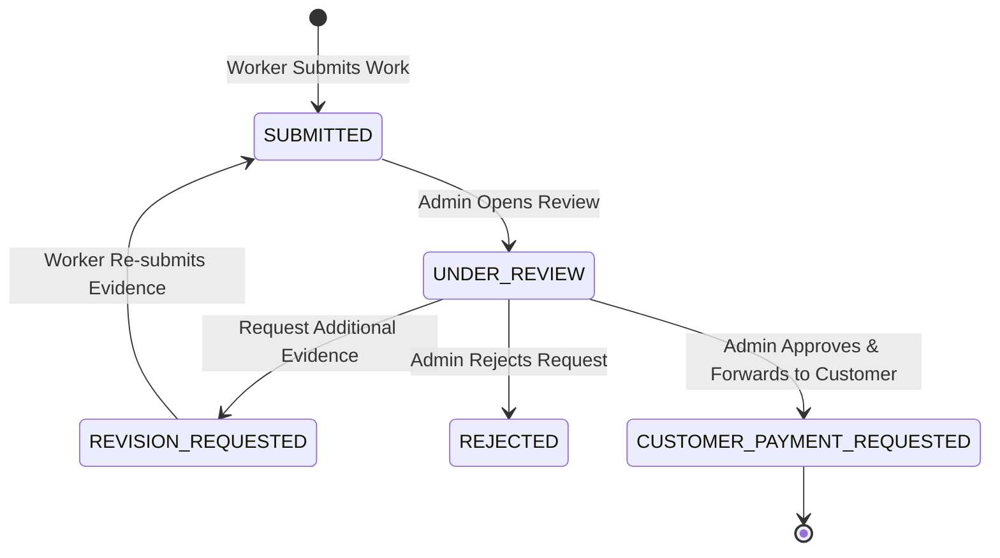

# ADMIN PAYMENT APPROVAL REPORT

**Project:** KAMLE AI Marketplace  
**Feature:** Admin Payment Request Management & Customer Invoicing  
**Status:** Implemented & Verified  

---

## 1. Overview

The Admin Payment Management system provides platform administrators with end-to-end visibility and control over worker completion submissions, customer payment requests, and payout disbursements.

---

## 2. Admin Decision State Machine

### Supported Admin Actions:
1. **Send to Customer (`send_to_customer`):** Marks payment request as `CUSTOMER_PAYMENT_REQUESTED` and customer payment status as `PENDING`. Triggers customer invoice notification.
2. **Approve (`approve`):** Internal approval of worker submission.
3. **Request Evidence / Clarification (`request_evidence`):** Sets status to `REVISION_REQUESTED` with documented administrator remarks.
4. **Reject (`reject`):** Rejects the payment request with explicit justification.
5. **Authorize Payout (`authorize_payout`):** Triggered once customer payment is confirmed. Records gateway payout reference (`pout_...`) and sets status to `PAID`.

---

## 3. Financial Controls & Immutability Rules

- **Price Lock:** The Admin cannot arbitrarily alter the original quotation amount approved between customer and worker.
- **Audit Trails:** All state changes are appended to the embedded `history[]` sub-document with the administrator's ID, action timestamp, and rationale remarks.
- **Payout Gate:** The "Authorize Payout" action is strictly disabled until backend verification confirms customer payment is settled in status `PAID`.
