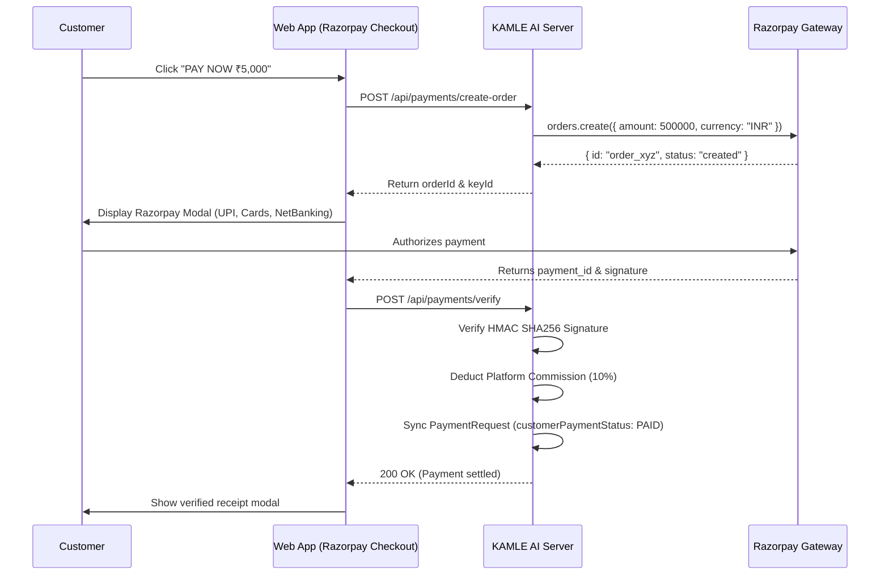

# CUSTOMER PAYMENT WORKFLOW

**Project:** KAMLE AI Marketplace  
**Feature:** Customer Payment Portal & Razorpay Checkout Integration  
**Status:** Implemented & Verified  

---

## 1. Customer Workflow Overview

When the Admin approves a worker's completion request and forwards it to the customer:
1. The customer sees an alert banner in **PENDING PAYMENTS** (`/dashboard/customer`).
2. The card outlines the assigned worker, completed service category, booking ID, agreed quotation amount, and worker completion notes.
3. The customer clicks **PAY NOW**.
4. Razorpay Checkout modal opens with test/production key.
5. Upon successful transaction, Razorpay returns `razorpay_order_id`, `razorpay_payment_id`, and `razorpay_signature`.
6. The client posts the payload to `POST /api/payments/verify`.
7. Backend verifies HMAC SHA256 signature, marks Payment as `COMPLETED`, updates PaymentRequest `customerPaymentStatus` to `PAID`, and schedules worker payout for admin authorization.
8. Instant receipt is displayed and stored in payment history.

