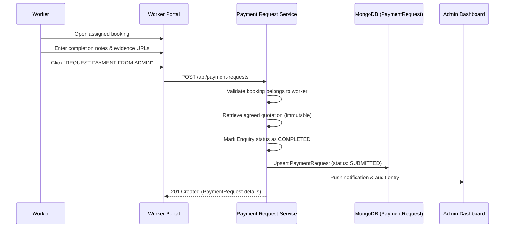

# WORKER PAYMENT REQUEST REPORT

**Project:** KAMLE AI Marketplace  
**Feature:** Worker Completion → Admin Payment Request Module  
**Status:** Implemented & Verified  

---

## 1. Architectural Overview

The Worker Payment Request module enables verified service workers to submit completion evidence for agreed bookings and request payment from the Admin.



---

## 2. API Specifications

### Endpoint
`POST /api/payment-requests`

### Authorization
- Role: `worker` only (`authenticate`, `authorize("worker")`)
- Ownership: Calling worker's user ID must strictly match `enquiry.workerId`.

### Request Payload
```json
{
  "enquiryId": "6ae97a7267c5619a5c9dc06c",
  "completionNotes": "All copper pipes replaced, tested under high pressure with zero leaks.",
  "completionEvidence": [
    "https://example.com/completion-photo-1.jpg"
  ]
}
```

### Validation & Business Rules
1. **Booking Association:** The worker must be assigned to the booking. Unassigned workers receive `403 Forbidden`.
2. **Quotation Immutability:** The service amount is strictly retrieved from the approved quotation (`quotation.approvedAmount` or `quotation.total`). Workers cannot provide or alter this amount.
3. **Idempotency:** If an open or approved payment request already exists for this booking, subsequent attempts return `409 Conflict`.
4. **State Transition:** The booking (`Enquiry`) status is automatically transitioned to `COMPLETED` with timestamp and actor details.

---

## 3. Worker Dashboard UI Components

- **Section:** `MY COMPLETED WORK / PAYMENT REQUESTS` (`client/src/components/dashboard/WorkerPaymentRequests.tsx`)
- **Key Display Elements:**
  - Booking & Service Category details
  - Agreed Quotation Amount (read-only)
  - Payment Request Status (`SUBMITTED`, `UNDER_REVIEW`, `CUSTOMER_PAYMENT_REQUESTED`, `APPROVED`)
  - Customer Payment Status (`PENDING`, `PAID`)
  - Platform Commission Deduction Breakdown
  - Net Worker Earnings
  - Payout Status & Gateway Transaction Reference
- **Action Modal:** "Request Payment From Admin" modal collecting completion notes and optional hosted photograph evidence.

