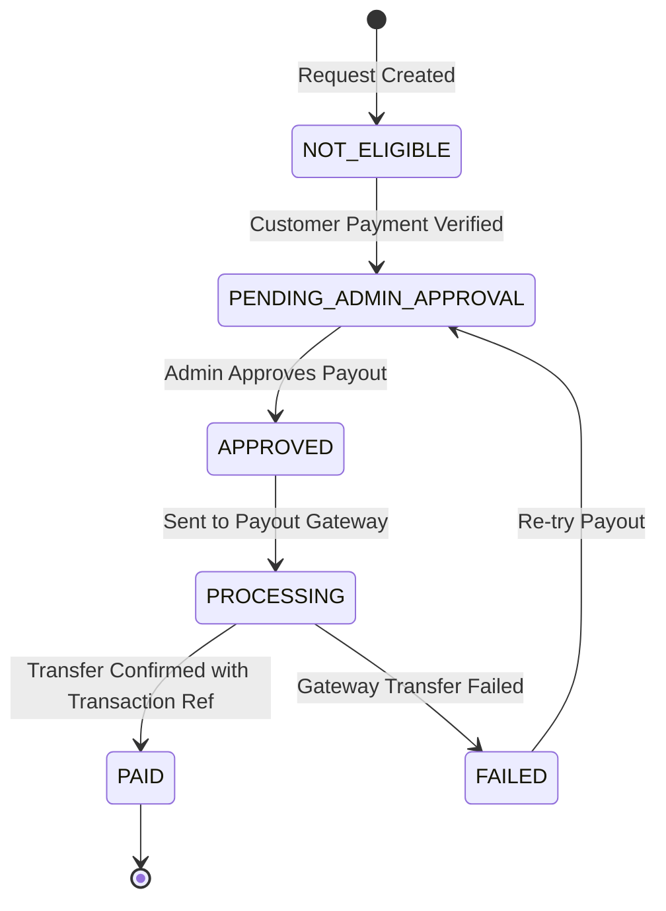

# WORKER PAYOUT IMPLEMENTATION

**Project:** KAMLE AI Marketplace  
**Feature:** Worker Payout Management & Bank Transfer Integration  
**Status:** Implemented & Verified  

---

## 1. Payout Lifecycle State Machine

---

## 2. Payout Processing Steps

1. **Customer Settlement:** Payment verification marks `customerPaymentStatus: PAID`.
2. **Payout Eligibility:** System checks whether manual admin approval is required. In the marketplace model, `payoutStatus` transitions to `PENDING_ADMIN_APPROVAL`.
3. **Admin Authorization:** Admin visits "Payment Requests" in Admin Dashboard, clicks **"Authorize Payout"**, enters the gateway provider reference (e.g. `pout_transfer_1793686403051`) and disbursement notes.
4. **Disbursement Record:** `Payout` model is transitioned to `PAID`, `processedAt` timestamp is recorded, and `PaymentRequest.payoutStatus` is updated to `PAID`.
5. **Worker Dashboard Update:** Worker earnings statistics (`netPayable`, `totalPaidOut`) immediately reflect the disbursement.

